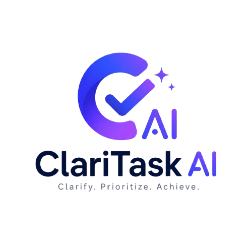

# ClariTaskAI

<p align="center">
  
</p>

<p align="center">
  <strong>Turn any task into simple steps. Work through them. Get things done.</strong>
</p>

<p align="center">
  
  
  
  
  
  
</p>

---

## 📌 Table of Contents

- [Overview](#-overview)
- [The Problem & The Solution](#-the-problem--the-solution)
- [Core Product Experience](#-core-product-experience)
- [Key Features](#-key-features)
- [Use Cases](#-use-cases)
- [Architecture & Tech Stack](#-architecture--tech-stack)
- [Project Directory Structure](#-project-directory-structure)
- [Getting Started](#-getting-started)
  - [Prerequisites](#prerequisites)
  - [Installation](#installation)
  - [Environment Configuration](#environment-configuration)
  - [Running the Application](#running-the-application)
- [Security & Best Practices](#-security--best-practices)
- [Contributing](#-contributing)
- [License](#-license)

---

## 🚀 Overview

**ClariTaskAI** is an AI-powered task breakdown and execution assistant engineered to turn unclear, ambitious, or overwhelming tasks into practical, sequential steps.

The product addresses the cognitive friction that prevents people from starting. By breaking complex goals into structured micro-actions, ClariTaskAI gives users immediate clarity on where to begin and keeps them focused on completing one step at a time.

> **Positioning:** ClariTaskAI is not a complex project manager or a passive to-do list bucket. It is a focused execution copilot that turns what you need to get done into simple actions you can actually take.

---

## 💡 The Problem & The Solution

### The Problem
People regularly struggle with tasks not from lack of motivation, but from **a lack of clarity on where to start**:
- A **student** needs to prepare for an exam but doesn't know how to organize the study schedule.
- A **developer** wants to build an app but feels daunted by architecture and staging.
- A **business owner** has an operational milestone but struggles to sequence execution.
- A **content creator** has a creative idea but gets stuck turning it into actionable production steps.
- Someone preparing a **special meal** or organizing a **home project** needs structured preparation steps.

### The Solution
ClariTaskAI replaces cognitive overload with immediate momentum:
1. **Describe** your task in plain everyday language (or using voice).
2. **Submit** to the AI breakdown engine.
3. **Receive** a clean, ordered sequence of practical steps.
4. **Execute** one step at a time, checking off progress until 100% complete.

---

## 🔄 Core Product Experience

```
Describe ➔ Break Down ➔ Take Action ➔ Complete
```

1. **Describe**: User enters an objective (e.g., *"Build a personal portfolio website"* or *"Prepare for Biology midterm"*).
2. **Break Down**: ClariTaskAI synthesizes the task into ordered, manageable steps with estimated durations and context.
3. **Take Action**: The user opens the dedicated task workspace, working through actionable items with clear focus.
4. **Complete**: Steps are checked off in real time, updating the visual progress meter until the task reaches completion.

---

## ✨ Key Features

- **🤖 AI Task Breakdown**: Automated conversion of natural language descriptions into practical, sequential steps via Supabase Edge Functions.
- **📋 Focused Task Workspace**: Distraction-free workspace with step-by-step checklist, explanations, and action completion toggles.
- **📊 Real-Time Progress Tracking**: Dynamic progress bars and percentage meters showing completion momentum.
- **🎙️ Voice Task Input**: Integrated speech-to-text allowing hands-free task creation.
- **🗂️ Task History & Management**: Full record of active and completed tasks with categorized tags.
- **🌐 Web-Exclusive Landing Page**: High-conversion, responsive landing page equipped with interactive workspace simulator, problem/solution breakdown, and persona showcases (accessible only on web).
- **🔒 Secure Authentication**: Robust authentication system supporting Email/Password and Google OAuth powered by Supabase Auth with Row-Level Security (RLS).
- **📱 Fully Responsive UI**: Tailored layouts adapting seamlessly across Mobile (< 650px), Tablet (650–1024px), and Desktop (>= 1024px).

---

## 🎯 Use Cases

| Category | Typical Task | Practical Breakdown Focus |
| :--- | :--- | :--- |
| **Studying** | *"Prepare for Biology midterm examination"* | Syllabus review, chapter cheatsheets, active recall, mock test |
| **Development** | *"Build a personal portfolio website"* | Section planning, tech stack selection, responsive UI, deployment |
| **Business** | *"Set up client onboarding & automated invoicing"* | Intake documentation, gateway configuration, email sequences |
| **Cooking & Home** | *"Prepare dinner party for 6 guests"* | Menu planning, categorized grocery list, prep-ahead scheduling |
| **Content Creation**| *"Produce and publish an educational tutorial"* | Script hook, screen recording, audio mastering, thumbnail design |
| **Personal Tasks** | *"Deep clean and organize the home office"* | Desk clearing, cable management, drawer categorization |

---

## 🛠️ Architecture & Tech Stack

ClariTaskAI follows **Clean Architecture** principles and a **feature-first** organization:

- **Frontend Framework**: [Flutter](https://flutter.dev/) (Dart 3, Null Safety)
- **State Management**: [flutter_bloc](https://pub.dev/packages/flutter_bloc) (Cubit pattern)
- **Dependency Injection**: [get_it](https://pub.dev/packages/get_it) & [injectable](https://pub.dev/packages/injectable)
- **Navigation & Routing**: [go_router](https://pub.dev/packages/go_router) (Guarded routes, web/native separation)
- **Backend & Database**: [Supabase](https://supabase.com/) (Auth, PostgreSQL, Realtime, Edge Functions)
- **Networking**: [Dio](https://pub.dev/packages/dio) & [supabase_flutter](https://pub.dev/packages/supabase_flutter)
- **Local Storage**: [flutter_secure_storage](https://pub.dev/packages/flutter_secure_storage) & [shared_preferences](https://pub.dev/packages/shared_preferences)
- **Speech Recognition**: [speech_to_text](https://pub.dev/packages/speech_to_text)
- **Responsive Layout**: [flutter_screenutil](https://pub.dev/packages/flutter_screenutil) + custom breakpoint extensions

---

## 📂 Project Directory Structure

```text
lib/
├── app/
│   ├── constants/         # App constants & compile-time configuration (AppKeys)
│   ├── theme/             # Global light/dark themes and design tokens
│   ├── app.dart           # MaterialApp.router root configuration
│   └── router.dart        # GoRouter definition with web/native routing guards
├── core/
│   ├── di/                # Dependency injection setup (get_it & injectable)
│   ├── error/             # Failure definitions & custom exceptions
│   ├── services/          # Supabase, Google Sign-In, and storage services
│   └── utils/             # Responsive helpers, validators, custom toasts
├── features/
│   ├── authentication/    # Auth, Signup, Forgot Password, Google OAuth
│   ├── home/              # Dashboard, active task list, stats & history
│   ├── landing/           # Web-only landing page (Navbar, Hero, Showcase, etc.)
│   ├── marketing_onbaording/ # Initial user onboarding flow
│   ├── personalization/   # User role and preference onboarding
│   ├── splash/            # Native platform startup & auth routing check
│   ├── tasks/             # Task creation interface & voice input
│   └── task_breakdown/    # Execution workspace, steps checklist & progress
└── shared/
    └── widgets/           # Reusable responsive containers & UI components
```

---

## 🏁 Getting Started

### Prerequisites

Ensure you have the following installed on your machine:
- **Flutter SDK**: `>=3.19.0` (Recommended: Flutter 3.44.x+)
- **Dart SDK**: `>=3.3.0`
- **Chrome** (for web development)
- **Android Studio / Xcode** (for mobile platforms)
- A **[Supabase](https://supabase.com/)** project with the `breakdown-task` Edge Function deployed

### Installation

1. **Clone the repository:**
   ```bash
   git clone https://github.com/Muhammad-Bashir24/claritask_ai.git
   cd claritask_ai
   ```

2. **Install dependencies:**
   ```bash
   flutter pub get
   ```

3. **Run code generation (if modifying entities/injectables):**
   ```bash
   dart run build_runner build --delete-conflicting-outputs
   ```

---

### Environment Configuration

ClariTaskAI reads configuration via compile-time environment defines or local `.env`.

Create a `.env` file in the project root:

```env
SUPABASE_URL=https://your-project.supabase.co
SUPABASE_ANON_KEY=your-anon-key-here
WEB_CLIENT_ID=your-google-web-client-id.apps.googleusercontent.com
IOS_CLIENT_ID=your-google-ios-client-id.apps.googleusercontent.com
```

> ⚠️ **Security Notice:** The `.env` file is excluded in `.gitignore` and should never be committed to source control.

---

### Running the Application

#### Option 1: Using `--dart-define-from-file` (Recommended)

Run on **Chrome (Web)**:
```bash
flutter run -d chrome --dart-define-from-file=.env
```

Run on **Android / iOS**:
```bash
flutter run --dart-define-from-file=.env
```

#### Option 2: Using the VS Code Debugger
A launch configuration is pre-configured in `.vscode/launch.json` that automatically passes `--dart-define-from-file=.env`. Simply press `F5` or select **Run Without Debugging**.

---

## 🛡️ Security & Best Practices

- **Zero Hardcoded Secrets**: All API endpoints and Supabase credentials are loaded dynamically via environment variables.
- **Row-Level Security (RLS)**: Database policies in Supabase ensure that users can only view, create, and edit their own tasks and task steps.
- **Guarded Web Landing Page**: The `/landing` route is strictly accessible when running in web environments (`kIsWeb`), while native mobile platforms route through `/splash`.

---

## 🤝 Contributing

Contributions, feedback, and feature requests are welcome!

1. Fork the Project
2. Create your Feature Branch (`git checkout -b feature/AmazingFeature`)
3. Commit your Changes (`git commit -m 'feat: add some amazing feature'`)
4. Push to the Branch (`git push origin feature/AmazingFeature`)
5. Open a Pull Request

---

## 📄 License

This project is licensed under the MIT License — see the [LICENSE](LICENSE) file for details.

---

<p align="center">
  Built with ❤️ for focused execution and clarity.
</p>
